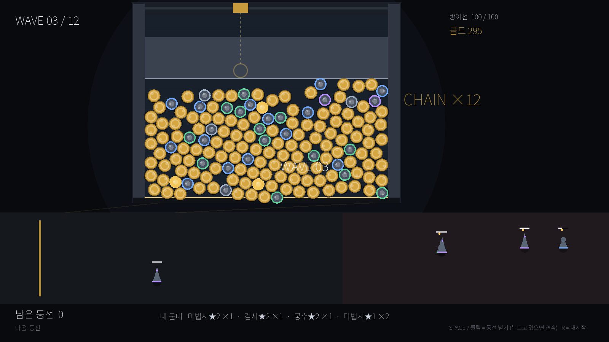

# 코인 군단 (Coin Legion, 가제)

동전 밀기 기계에 동전을 떨어뜨리면, 판 위 병사 피규어가 밀려 떨어져 내 군대로 출격하는 **원버튼 오토배틀 디펜스 로그라이크**.

> 핵심 재미: "동전 하나 넣었더니 병사가 와르르 떨어져 내 군대가 된다."

## 실행 방법 (PC)
1. [Godot 4.3](https://godotengine.org/download/archive/4.3-stable/) 표준판(Standard)을 받아 압축을 푼다 (설치 불필요)
2. Godot 실행 → **Import** → 이 저장소의 `game/project.godot` 선택
3. 에디터가 열리면 **F5** (또는 오른쪽 위 ▶)

## 조작
- **SPACE / 마우스 왼쪽 클릭**: 동전 넣기 (누르고 있으면 연속)
- **R**: 다시 시작

## 프로토타입 v0.1에 들어간 것
- 좌우로 움직이는 투입구, 앞뒤로 움직이는 미는 판, 동전 물리
- 판 끝에서 떨어진 동전 = 골드, 병사 피규어 = 전장에 출격
- 같은 병사 3개 = 자동 승급 (최대 ★3)
- 8번째 동전마다 폭발 동전 (주변을 날려 와르르 유도)
- 자동 전투, 웨이브 12개, 5웨이브마다 보스, 방어선 체력
- 웨이브 클리어 시 동전 +10, 병사 피규어 4개 보충

## 폴더
- `game/` Godot 프로젝트 · `game/data/balance.json` 모든 밸런스 숫자
- `game/tests/` 자동 테스트 (`run_tests.gd`), 자동 화면 캡처 (`screenshot.gd`)
- `docs/` 기획, 설계, QA, 홍보, 방향 문서
- `.claude/agents/` AI 직원 5명 (홍보, 설계, 문제점 발견, 방향성, 신게임)
- `CLAUDE.md` 팀 규칙 (AI가 매번 먼저 읽음)

## 라이선스 메모
- 폰트: Noto Sans KR (SIL Open Font License, `game/fonts/OFL.txt`)
